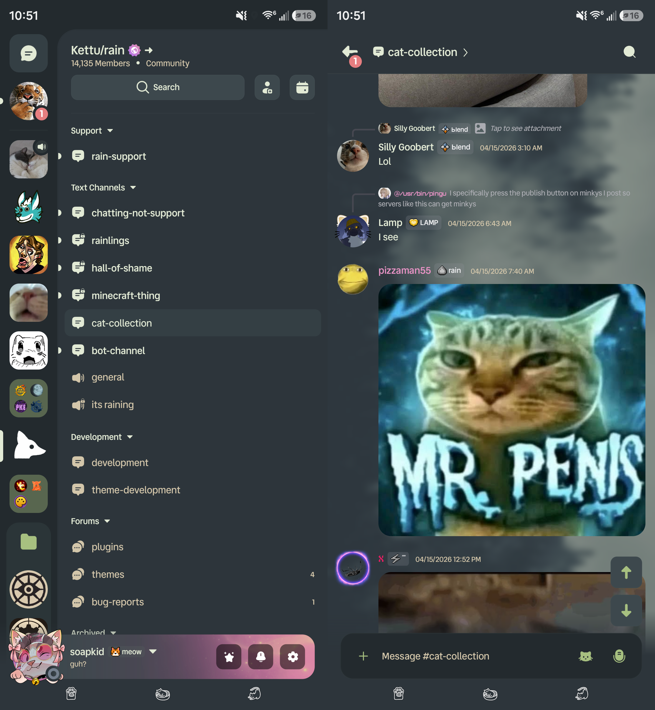

## rainForest | Everforest Medium for Rain/Kettu
### rainForest brings [everforest](https://everforest.vercel.app/) to the Discord clients [Rain](https://www.raincord.dev/) and [Kettu](https://www.raincord.dev/kettu). It provides a calming, muted-green color scheme well-suited for everyday use.
> [!IMPORTANT]
> This is something I work on in my spare time, so it probably won't be perfect. If anything looks off to you or you have a request, please let me know! While this theme _should_ be compatible with Kettu, I personally only use Rain. As a result, any Kettu-specific issues are not necessarily my priority. Please feel free to share them with me anyway, and I'll see what I can do.
# Install
To install the theme, select a variant from below and import the link as a new theme.

_The background image and icon pack may be toggled from within the app._
### [rainForest Default](https://raw.githubusercontent.com/soap-kid/NeuForest/refs/heads/main/rainForest.json)
Everforest Dark Medium with Solar icon pack.

### [rainForest Duotone](https://raw.githubusercontent.com/soap-kid/rainForest/refs/heads/main/rainForest%20duotone.json)
Everforest Dark Medium with Solar (Duotone) icon pack.

### [rainForest Plumpy](https://raw.githubusercontent.com/soap-kid/rainForest/refs/heads/main/rainForest%20plumpy.json)
Everforest Dark Medium with Roseicord Plumpy icon pack.

# Fontpack (optional):
### [rainForest Fonts](https://raw.githubusercontent.com/soap-kid/NeuForest/refs/heads/main/rainForestFonts.json)
> [!IMPORTANT]
> Space Mono unfortunately seems to mess with Discord's default text scaling a bit. If you'd like to use this font pack (and of course you do!), I recommend lowering your zoom level in your app's appearance settings (75% looks best to me.)

## Preview

